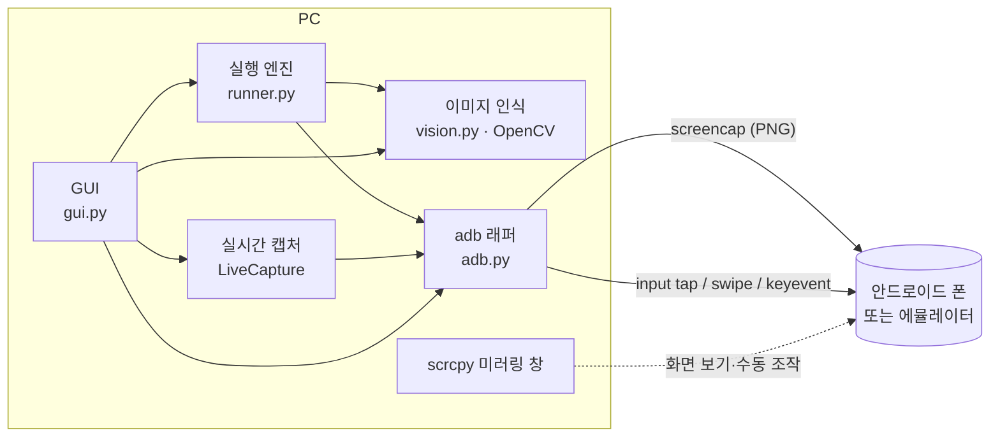
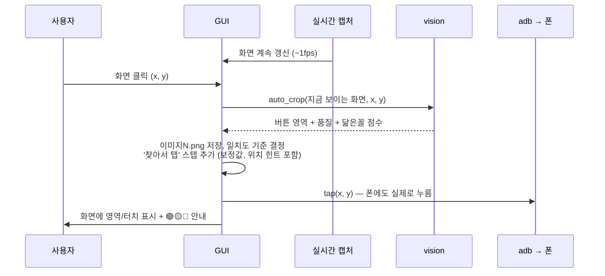
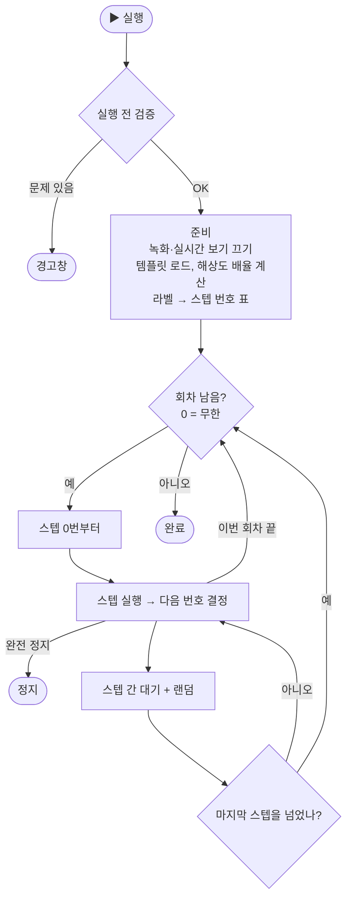

# 모두의 매크로 — 동작 방식

이 문서는 프로그램 내부가 어떻게 돌아가는지 설명한다. 사용법만 필요하면 [README](../README.md)를 보면 된다.

---

## 1. 한눈에 보기

PC가 폰을 **보고(캡처) → 판단하고(이미지 찾기) → 누르는(탭)** 과정을 반복하는 구조다.
폰에는 아무것도 설치하지 않는다. 모든 통신은 안드로이드 기본 디버깅 도구인 **adb**로 한다.



| 구성 요소 | 역할 |
|---|---|
| **adb** | 폰 화면 캡처, 터치/키 입력 전송 |
| **OpenCV** | 화면에서 버튼 이미지 찾기, 버튼 테두리 인식, 이미지 품질 평가 |
| **PySide6 (Qt)** | GUI |
| **scrcpy** | (선택) 폰 화면을 고화질로 보는 별도 창. 매크로 엔진과는 무관하다 |

---

## 2. 파일 구조

```
macro_maker/
├─ main.py              진입점
├─ mm/
│  ├─ adb.py            adb 명령 래퍼 (캡처, 탭, 연결, 페어링)
│  ├─ vision.py         템플릿 매칭, 품질 평가, 자동 자르기
│  ├─ model.py          스텝 종류 정의, 매크로 저장/불러오기
│  ├─ runner.py         실행 엔진 (별도 스레드)
│  ├─ step_dialog.py    스텝 편집 창 (필드 정의로 자동 생성)
│  ├─ dialogs.py        기기 연결 도우미, 실행 설정 창
│  └─ gui.py            메인 창 (화면 뷰, 녹화, 편집)
├─ tools/scrcpy-win64-v4.1/   scrcpy.exe + adb.exe (setup.bat이 받음)
└─ macros/<매크로이름>/        사용자가 만든 매크로
   ├─ macro.json
   └─ templates/*.png
```

---

## 3. 폰과 통신하는 방법 (`adb.py`)

| 동작 | 실제 adb 명령 |
|---|---|
| 기기 목록 | `adb devices` (3초마다 자동 확인 → 꽂으면 바로 인식) |
| 기기 이름 | `adb shell getprop ro.product.model` |
| 에뮬레이터/무선 연결 | `adb connect 127.0.0.1:5555` 등 |
| 무선 페어링 (안드로이드 11+) | `adb pair IP:포트 코드` |
| 화면 캡처 | `adb exec-out screencap -p` → PNG → OpenCV 이미지 |
| 탭 | `adb shell input tap X Y` |
| 길게 누르기 | `adb shell input swipe X Y X Y ms` (같은 점으로 스와이프) |
| 스와이프 | `adb shell input swipe X1 Y1 X2 Y2 ms` |
| 버튼 | `adb shell input keyevent KEYCODE_BACK` 등 |
| 글자 입력 | `adb shell input text ...` (**한글 안 됨**) |

캡처 한 번에 **약 0.3~1초**가 걸린다. 실시간 보기와 이미지 인식 속도의 상한이 여기서 정해진다.

### 기기 연결 도우미 (`dialogs.ConnectDialog`)

1.5초마다 `adb devices`를 확인해서 상태를 색으로 보여준다.

| 상태 | 표시 |
|---|---|
| 연결 안 됨 | ❌ 빨강 + 안내 따라하기 |
| `unauthorized` | ⚠️ 노랑: "폰에서 USB 디버깅 허용을 누르세요" |
| `device` | ✅ 초록: 기기 모델명 |

- **에뮬레이터 자동 찾기**: 에뮬레이터들이 쓰는 대표 포트(5555, 5557, 5559, 5565, 5575, 7555, 16384, 16416, 62001, 62025, 21503)에 `adb connect`를 차례로 시도한다.
- 프로그램을 켰을 때 연결된 기기가 없으면 도우미가 자동으로 열린다.

---

## 4. 이미지 인식 (`vision.py`)

### 4.1 템플릿 매칭

OpenCV `matchTemplate`(`TM_CCOEFF_NORMED`)으로 템플릿을 화면 위에서 한 픽셀씩 밀어 가며 닮은 정도를 0~1 점수로 매긴다. 스텝의 **일치도 기준**(기본 0.85) 이상이면 "찾음"이다.

### 4.2 해상도 자동 보정

매크로에 **만든 기기의 해상도**(`resolution`)를 저장해 둔다. 실행할 때 기기 해상도가 다르면
- 배율 `sx = 현재폭/기준폭`, `sy = 현재높이/기준높이`를 구한다.
- 템플릿을 **sx × [1.0, 0.96, 1.04, 0.92, 1.08]** 배율로 차례로 리사이즈해서 찾는다(0.95 이상이면 멈춤). 기기마다 UI 배율이 미묘하게 달라서다.
- 좌표 스텝과 탭 보정값도 `sx`, `sy`를 곱해서 변환한다.

> 테스트: 1080x2400에서 만든 매크로를 720x1600에서 실행했을 때 일치도 0.95, 좌표 (600,1240) → (398,826).

### 4.3 똑같은 게 여러 개일 때: 가까운 것 고르기

이미지 스텝에는 등록할 때의 이미지 중심 위치(`hint_x`, `hint_y`)가 저장된다. 실행할 때는
1. 최고 점수를 구한 뒤 `max(최고점 - 0.05, 일치도 기준)` 이상인 위치를 모두 후보로 잡고,
2. 후보 중 **녹화 위치(× 배율)에서 가장 가까운 곳**을 고른다.

그래서 화면에 똑같은 "START" 버튼이 두 개 있어도, 오른쪽을 녹화했으면 실행할 때도 오른쪽을 누른다. 후보가 하나뿐이면 그냥 그것을 쓴다(위치가 바뀌어도 찾는다).

### 4.4 품질 평가 (`quality`)

이미지를 등록하는 순간 그 이미지가 실행 때 잘 찾아질지를 평가한다.

| 결과 | 조건 |
|---|---|
| 🔴 나쁨 | 12px 미만 / 화면의 20% 초과(배경 변화에 취약) / 무늬 없음(회색조 표준편차 < 6) |
| 🟡 주의 | **화면의 다른 곳**에 일치도 0.85 이상인 닮은꼴이 있음 / 20px 미만 |
| 🟢 좋음 | 그 밖 |

닮은꼴 검사: 화면 전체에 템플릿을 매칭하고, **자기 자리 주변(템플릿 크기의 절반 범위)을 지운 뒤** 남은 최고 점수를 본다. 속도를 위해 절반 해상도로 계산한다.

🟡 닮은꼴일 때는 자동으로 대응한다.
- **일치도 기준을 `닮은꼴 점수 + 0.03`으로 올린다** (0.85~0.93 범위). 진짜 버튼은 같은 해상도에서 ~1.0, 해상도 보정 시 ~0.95가 나오므로 0.93을 넘기지 않는다.
- 그래도 구분이 안 될 만큼 똑같으면 4.3의 "가까운 것 고르기"에 맡기고 그렇다고 안내한다.

### 4.5 자동 자르기 (`auto_crop`): 녹화 모드

누른 점 `(x, y)` 주변에서 후보를 만들어 품질을 평가하고 가장 좋은 것을 고른다.

1. **버튼 테두리 후보**: 회색조 → 블러 → Canny 윤곽선 → 팽창 → 외곽선 찾기. 그중 **누른 점을 감싸는** 사각형(한 변 ≥ 기본 크기의 40%, 면적 ≤ 화면 15%)을 작은 것부터 최대 4개 고르고, 4px 여유를 둔다. 글자 위를 눌러도 버튼 전체가 잡힌다.
2. **정사각형 후보**: 기본 크기(화면 짧은 변의 9%, 최소 48px) × [1.0, 1.5, 0.7, 2.0, 2.8]
3. 순서대로 평가하다가 🟢가 나오면 멈추고, 끝까지 없으면 **(등급, 닮은꼴 점수가 낮은 순)**으로 최선을 고른다.

탭할 위치는 이미지 중심과 실제 누른 점의 차이를 **탭 위치 보정(offset)**으로 저장해서, 누른 그 자리를 그대로 누른다.

> 테스트: 220x90 버튼의 글자 위를 클릭 → 228x98(버튼 전체)로 잘림, 🟢. 같은 스타일의 다른 글자 버튼은 닮은꼴 0.79로 구분됨. 약 30ms.

### 4.6 한글 경로

`cv2.imread/imwrite`는 Windows 한글 경로를 못 다뤄서 `np.fromfile + imdecode`, `imencode + tofile`로 우회한다.

---

## 5. 매크로 만들기

### 5.1 녹화 모드 (● 녹화, F9)



| 입력 | 판정 | 결과 |
|---|---|---|
| 클릭 | 이동 < 6px, 600ms 미만 | 이미지 찾아서 탭 |
| 꾹 누르기 | 이동 < 6px, 600ms 이상 | 길게 누르기 (누른 시간) |
| 드래그 | 이동 ≥ 6px | 스와이프 (드래그 시간, 100~2000ms) |
| ◀ 뒤로 / ⌂ 홈 | 툴바 버튼 | 버튼 스텝 |

- 녹화를 켜면 실시간 보기가 강제로 켜지고, 화면 테두리가 빨갛게 바뀌며 안내 배너가 표시된다.
- 스텝은 목록 맨 끝(또는 선택한 스텝 다음)에 이어서 쌓인다.
- 이미지를 자르는 기준은 **사용자가 보고 누른 그 화면**이다(최대 1초 정도 지난 화면일 수 있음). 그래서 화면이 바뀐 걸 확인하고 다음 터치를 하라고 안내한다.
- "찾아서 탭"은 실행할 때 버튼이 나타날 때까지 기다리므로(기본 10초) 녹화 중의 시간 간격은 따로 저장하지 않는다.

### 5.2 편집 모드

- **드래그**: 영역 선택 → 메뉴(찾아서 탭 / 나타날 때까지 / 사라질 때까지 / 등록만). 드래그하는 동안 커서 주변 60px를 3배로 보여주는 **돋보기**와 선택 크기가 표시된다.
- **클릭**: 좌표 탭, 길게 누르기, 스와이프(두 번 클릭), 바로 탭 테스트
- 직접 등록한 이미지도 4.4 품질 평가와 자동 일치도 조정이 똑같이 적용된다.

### 5.3 공통

- 이미지 이름은 `이미지1, 이미지2…`로 자동으로 붙는다(빈 번호부터). F2로 바꾸면 그 이미지를 쓰는 스텝도 같이 바뀐다.
- 화면 좌표는 **기기 실제 픽셀** 기준이다. 미리보기가 축소되어 보여도 원본 픽셀로 환산해서 저장한다.
- 모든 변경은 바로 `macro.json`에 저장된다.
- adb 호출은 전부 백그라운드 스레드에서 돌리고, 결과만 Qt 시그널로 UI에 넘긴다.
- 매크로의 기준 해상도와 다른 화면(회전, 다른 기기)이 들어오면 한 번 경고한다.

---

## 6. 스텝 정의 방식 (`model.py`)

스텝 종류마다 **필드 목록**만 정의해 두면 편집 창, 기본값, 목록 표시 문구가 자동으로 만들어진다.

```python
"tap_image": ("이미지 찾아서 탭", [
    ("template",  "이미지",         "template", ""),
    ("threshold", "일치도",         "float",    0.85),
    ("timeout",   "최대 대기 (초)", "float",    10.0),
    ...
])
```

| kind | 편집 위젯 |
|---|---|
| `int` / `float` / `str` | 숫자 / 실수 / 글자 입력칸 |
| `template` | 등록된 이미지 목록 |
| `label` | 라벨 목록 (비우면 "다음 스텝") |
| `fail` | 완전 정지 / 이번 회차 끝 / 다음 스텝 / 라벨로 이동 |
| `choice:A,B,C` | 고정 선택지 |

`hint_x`, `hint_y`처럼 필드 목록에 없는 값은 편집 창에 나오지 않고 그대로 보존된다.

메뉴는 일반 사용자용(이미지 / 터치 / 기타 / 끝내기)과 **고급: 분기·반복**(있으면 분기, 라벨, 라벨로 이동)으로 나뉜다. 반복은 대부분 **전체 반복 횟수**만으로 충분하다.

---

## 7. 실행 엔진 (`runner.py`)

### 7.1 전체 흐름



**실행 전 검증**: 이미지 존재 여부, 이동할 라벨 존재 여부, 라벨 중복, 예약어(`stop`, `end`, `next`)를 라벨 이름으로 썼는지, "라벨로 이동"에 라벨이 지정됐는지

### 7.2 프로그램 카운터 방식

엔진은 "지금 몇 번 스텝인지"(`i`)만 들고 다니고, 각 스텝은 끝나면 **다음에 실행할 번호**를 돌려준다. 보통은 `i+1`이고, 분기와 이동은 라벨의 위치를 돌려준다. 라벨 자체는 아무것도 안 하는 표지판이다.

### 7.3 스텝별 동작

| 스텝 | 동작 |
|---|---|
| **찾아서 탭** | 최대 `timeout`초 동안 `캡처 → 찾기(4.2, 4.3)`를 `poll` 간격으로 반복한다. 찾으면 `중심 + 보정값×배율 + 랜덤 흔들림`을 탭한다 |
| **나타날 때까지 대기** | 위와 같은데 탭하지 않는다 |
| **사라질 때까지 대기** | 일치도가 기준 미만이 될 때까지 반복한다 |
| **있으면 분기** | 한 번만 확인해서 `then` 또는 `else` 라벨로 간다 |
| **좌표 탭 / 길게 / 스와이프** | 좌표 × 배율 + 랜덤 흔들림 |
| **대기** | `ms + 0~jitter ms` |
| **이번 회차 끝** | 남은 스텝을 건너뛰고 다음 회차로 간다(회차가 남아 있으면) |
| **완전 정지** | 반복 횟수와 상관없이 매크로 전체를 끝낸다 |
| **라벨로 이동** | 7.4 참고 |

**이미지를 끝내 못 찾았을 때** (`on_fail`)

| 값 | 동작 |
|---|---|
| `stop` (기본) | 완전 정지. 녹화된 스텝은 이게 기본값이다. 예상한 화면이 안 나오면 엉뚱한 곳을 누르지 않고 멈추는 게 안전해서다 |
| `end` | 이번 회차 끝 → 다음 회차 |
| `next` | 무시하고 다음 스텝 |
| 라벨 이름 | 그 라벨로 이동 |

### 7.4 반복

- **전체 반복** (`settings.loops`, 0 = 무한): 스텝 목록 전체를 N번 돈다. 매크로에 같이 저장된다.
- **라벨로 이동**(고급): 이동 스텝마다 카운터가 따로 있다. `반복 횟수 = 3`이면 3번 되돌아가고, 4번째에는 아래로 내려가면서 카운터를 0으로 초기화한다(중첩 반복 가능). 카운터는 회차가 바뀔 때마다 새로 시작한다.

### 7.5 사람처럼 보이게 하는 랜덤 요소 (실행 설정 창)

| 설정 | 기본값 | 의미 |
|---|---|---|
| 스텝 사이 대기 | 300ms | 라벨, 이동, 대기 스텝 뒤에는 넣지 않음 |
| 대기 랜덤 추가 | 0~200ms | |
| 탭 위치 흔들림 | ±4px | |
| 이미지 재확인 간격 | 0.4초 | |

### 7.6 스레드와 정지

- 엔진은 별도 스레드에서 돌고 `log`, `step_changed`(현재 줄 강조), `frame`(화면 + 찾은 위치 초록 박스), `finished` 시그널을 보낸다.
- 모든 대기는 `threading.Event.wait()`로 처리해서 F8을 누르면 대기 중이어도 **즉시**(테스트상 0.02초) 멈춘다. 이미 실행 중인 adb 명령은 그 명령이 끝난 뒤에 멈춘다.
- 실행 중에는 실시간 캡처를 끄고(엔진이 화면을 보내줌), 끝나면 원래 상태로 되돌린다.

---

## 8. 매크로 파일 포맷 (version 2)

```json
{
  "name": "매크로_1002_1530",
  "version": 2,
  "resolution": [1080, 2400],
  "settings": { "loops": 0, "step_delay": 300, "delay_jitter": 200, "tap_jitter": 4, "poll": 0.4 },
  "templates": {
    "이미지1": { "level": "good", "msg": "좋아요" },
    "이미지2": { "level": "warn", "msg": "비슷하게 생긴 게 화면에 또 있어요 (일치도 0.90) → ..." }
  },
  "steps": [
    { "type": "tap_image", "template": "이미지1", "threshold": 0.85, "timeout": 10.0,
      "offset_x": -3, "offset_y": -2, "hint_x": 510, "hint_y": 1545, "on_fail": "stop" },
    { "type": "swipe", "x1": 536, "y1": 1954, "x2": 539, "y2": 1200, "ms": 266 },
    { "type": "end_round" }
  ]
}
```

- `templates`는 품질 평가 결과(목록 색상과 툴팁에 쓰임)다. 지워진 이미지는 저장할 때 자동으로 정리된다.
- 불러올 때 빠진 필드는 기본값으로 채운다. version 1 매크로도 그대로 열린다. 단, **version 1의 "정지/매크로 종료"는 "이번 회차 끝"처럼 동작했지만 이제는 완전 정지다.**
- 폴더를 통째로 복사하면 공유된다. 해상도가 달라도 4.2 자동 보정이 적용된다.

---

## 9. 한계와 알려진 점

| 항목 | 내용 |
|---|---|
| 속도 | 캡처 1회에 0.3~1초 → 실시간 보기는 약 1fps. 빠른 반응이 필요한 게임(리듬게임 등)은 어렵다 |
| 보안 화면 | 캡처를 막는 앱(FLAG_SECURE)은 검은 화면이 나온다 |
| 똑같은 버튼 | 위치 힌트로 구분하지만, 화면 배치 자체가 바뀌는 게임에서는 엉뚱한 걸 누를 수 있다(🟡로 표시됨) |
| 회전/비율 | 템플릿 회전은 지원하지 않는다. 화면 비율이 크게 다르면 좌표 스텝이 어긋날 수 있다 |
| 한글 입력 | `adb input text`는 영문과 숫자만 된다 |
| iOS | 지원하지 않는다 |
| 검증 범위 | 가짜 기기로 엔진, 녹화, 재생, 해상도 보정 테스트를 했다. **실기기 e2e는 아직 안 했다** |
| 약관 | 대부분의 게임은 매크로를 금지한다. 계정 제재 위험은 사용자 책임이다 |
